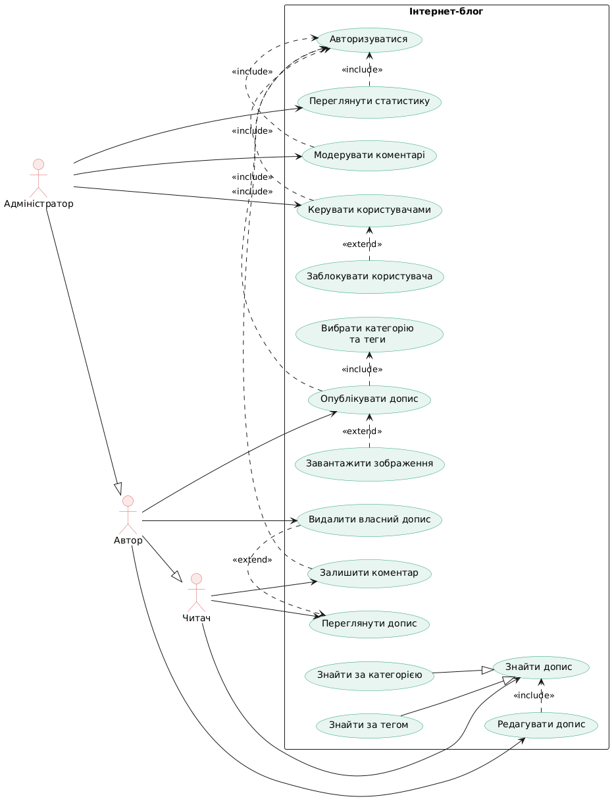
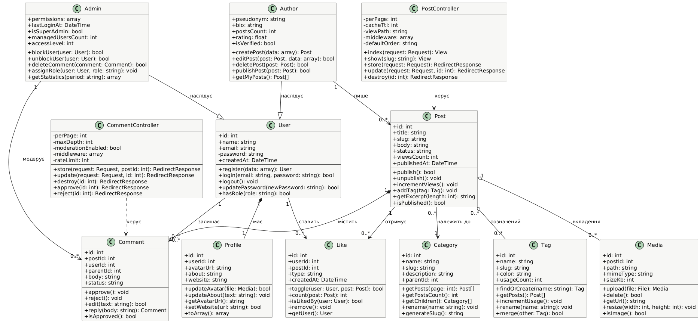

# Архітектура та проєктування системи «Інтернет-блог»

Лабораторна робота 2. Веб-програмування (PHP/Laravel). Виконав: Гошовський Денис Миколайович, група КН-41.

## 1. Предметна галузь та характеристики системи

Інтернет-блог — це веб-система на базі PHP/Laravel для публікації авторських матеріалів, їх систематизації за категоріями й тегами та обговорення читачами в коментарях. Автори ведуть блог без знання верстки, читачі швидко знаходять потрібний контент, а адміністратор керує користувачами й модерує вміст.

### Основні функції

1. Реєстрація, авторизація та керування профілем користувача (вбудована автентифікація Laravel).
2. Створення, редагування, видалення й публікація дописів, збереження чернеток, відкладена публікація.
3. Класифікація дописів за категоріями та тегами.
4. Перегляд стрічки дописів із пагінацією, пошук і фільтрація за категорією, тегом та ключовим словом.
5. Коментування дописів, вкладені відповіді, модерація коментарів.
6. Вподобайки до дописів.
7. Завантаження та зберігання зображень до допису.
8. Адміністративна панель: керування користувачами та ролями, блокування, перегляд статистики блогу.

### Користувачі

- **Читач** — відвідувач блогу (гість або зареєстрований користувач): переглядає й шукає дописи, залишає коментарі та вподобайки.
- **Автор** — зареєстрований користувач із правом публікації; успадковує всі можливості читача, створює, редагує й видаляє власні дописи.
- **Адміністратор** — успадковує можливості автора; модерує коментарі, керує користувачами, ролями та категоріями, переглядає статистику.

### Архітектура (MVC)

Система будується за архітектурою MVC (Model — View — Controller), на якій базується Laravel:

- **Model** — Eloquent-моделі User, Post, Comment, Category, Tag, Media, Like, Profile; відношення описуються методами hasMany, belongsTo, belongsToMany; структура таблиць задається міграціями.
- **View** — Blade-шаблони в resources/views: стрічка дописів, сторінка допису з коментарями, форма допису, панель автора та адміністратора.
- **Controller** — PostController, CommentController та контролери адмін-панелі; приймають запит, перевіряють дані (Form Request), викликають моделі й повертають View.
- **Маршрутизація та безпека** — routes/web.php, middleware auth та role, політики доступу (Policies), захист CSRF.

### Сценарії роботи

1. **Читання й коментування.** Читач відкриває головну сторінку, обирає категорію, відкриває допис, читає його, авторизується й залишає коментар.
2. **Публікація допису.** Автор відкриває форму нового допису, вводить заголовок і текст, обирає категорію та теги, завантажує зображення й публікує допис.
3. **Модерація.** Адміністратор переглядає нові коментарі, відхиляє спам і блокує користувача, який порушує правила.
4. **Реєстрація користувача.** Гість заповнює форму реєстрації, система перевіряє дані, створює обліковий запис із роллю «Читач» і виконує вхід.

### Логічні сутності

- **User** — користувач системи (ролі reader, author, admin; Author і Admin є спеціалізаціями User)
- **Profile** — додаткові дані профілю: аватар, опис, сайт
- **Post** — допис блогу: заголовок, текст, статус, лічильник переглядів
- **Comment** — коментар до допису, підтримує вкладені відповіді та статус модерації
- **Category** — категорія допису (може мати батьківську категорію)
- **Tag** — тег для гнучкої класифікації дописів
- **Media** — файл (зображення), прикріплений до допису
- **Like** — вподобайка користувача до допису

### Таблиці бази даних

| Таблиця | Основні поля |
|---|---|
| `users` | id, name, email, password, role, is_blocked, created_at |
| `profiles` | id, user_id, avatar_url, about, website |
| `posts` | id, user_id, category_id, title, slug, body, status, views_count, published_at |
| `comments` | id, post_id, user_id, parent_id, body, status, created_at |
| `categories` | id, parent_id, name, slug, description |
| `tags` | id, name, slug, color |
| `post_tag` | post_id, tag_id (зв'язна таблиця «багато до багатьох») |
| `media` | id, post_id, path, mime_type, size_kb |
| `likes` | id, user_id, post_id, type, created_at |

Класи Author та Admin окремих таблиць не мають: вони зберігаються в таблиці users за допомогою поля role, а специфічна поведінка реалізується через політики доступу й окремі класи-обгортки.

### Вихідні дані

- **Стрічка дописів** — таблиця/список дописів із заголовком, автором, категорією, датою та кількістю коментарів, з пагінацією.
- **Сторінка допису** — повний текст допису, теги, кількість переглядів і вподобайок, дерево коментарів.
- **Звіт «Статистика блогу»** — таблиця за обраний період: кількість нових дописів, коментарів, реєстрацій і переглядів.
- **Графік активності** — лінійний графік динаміки публікацій і переглядів по днях за місяць.
- **Звіт «Топ-10 дописів»** — рейтинг найпопулярніших дописів за переглядами та вподобайками.

## 2. Use Case у повній формі: «Опублікувати допис»

| Розділ | Опис |
|---|---|
| Use Case Name | Опублікувати допис |
| Scope | Система «Інтернет-блог» (System) |
| Level | User-goal |
| Primary Actor | Автор |
| Stakeholders and interests | 1. Автор: хоче швидко опублікувати допис без втрати введеного тексту та помилок форматування. 2. Читачі: зацікавлені в якісному, правильно класифікованому контенті, який легко знайти. 3. Адміністратор: зацікавлений у відсутності спаму й порушень та в простому контролі публікацій. 4. Власник блогу: зацікавлений у зростанні аудиторії та регулярному оновленні контенту. |
| Preconditions | Автор авторизований у системі. Обліковий запис автора не заблоковано, роль — «Автор» або «Адміністратор». |
| Success guarantee | Допис збережено в базі даних зі статусом «published» і прив'язано до автора, категорії та тегів. Допис доступний за унікальним slug і відображається в стрічці. Автор отримав підтвердження публікації. |

**Main Success Scenario:**

1. Автор натискає «Новий допис» на панелі автора.
2. Система відображає форму допису (заголовок, текст, категорія, теги, зображення).
3. Автор вводить заголовок і текст допису.
4. Автор обирає категорію зі списку та додає теги.
5. Автор за потреби завантажує зображення до допису.
6. Автор натискає «Опублікувати».
7. Система перевіряє введені дані (обов'язкові поля, довжину, формат файлу).
8. Система генерує унікальний slug із заголовка.
9. Система в одній транзакції зберігає допис зі статусом «published» та датою публікації, прив'язує теги й зберігає запис про зображення.
10. Система очищає кеш стрічки й оновлює лічильник дописів автора.
11. Система перенаправляє автора на сторінку допису та показує повідомлення «Допис опубліковано».
12. Допис з'являється в загальній стрічці для читачів.

**Extensions:**

- **3a)** Автор не завершив допис і хоче зберегти його як чернетку:
  1. Автор натискає «Зберегти чернетку».
  2. Система зберігає допис зі статусом «draft», вимагаючи лише заголовок.
  3. Допис видно лише автору, публікацію можна продовжити пізніше.
- **4a)** Потрібної категорії немає в списку:
  1. Автор обирає «Без категорії» або просить адміністратора створити категорію.
  2. Автор продовжує публікацію.
- **5a)** Зображення має недопустимий формат або перевищує 2 МБ:
  1. Система відхиляє файл і показує повідомлення про помилку.
  2. Автор обирає інший файл або публікує допис без зображення.
- **6a)** Автор хоче запланувати публікацію:
  1. Автор вказує дату й час публікації.
  2. Система зберігає допис зі статусом «scheduled».
  3. Планувальник завдань Laravel публікує допис у вказаний час.
- **7a)** Перевірка даних не пройдена (порожній заголовок чи текст):
  1. Система повертає форму зі збереженими даними та повідомленнями про помилки.
  2. Автор виправляє дані й повторює крок 6.
- **8a)** Допис з таким slug уже існує:
  1. Система додає до slug числовий суфікс (наприклад, my-post-2) і продовжує збереження.
- **9a)** Збій бази даних або файлового сховища:
  1. Система відкочує транзакцію та записує помилку в лог.
  2. Автор бачить повідомлення «Не вдалося зберегти допис, спробуйте пізніше», введені дані залишаються у формі.
- ***a)** У будь-який час завершується сесія автора:
  1. Система перенаправляє на сторінку входу.
  2. Після входу система відновлює останню автозбережену чернетку.

**Special Requirements:**

1. Збереження допису має виконуватися не довше 2 секунд.
2. Захист від CSRF та очищення HTML-вмісту від XSS.
3. Адаптивна форма для комп'ютерів і мобільних пристроїв.
4. Підтримка Markdown або WYSIWYG-редактора.

**Technology and Data Variations List:**

1. Текст вводиться через Markdown- або WYSIWYG-редактор.
2. Зображення завантажується вибором файлу або перетягуванням (drag-and-drop).
3. Файли зберігаються локально (storage/app/public) або в хмарному сховищі через Storage facade.
4. Теги вводяться вручну або вибираються за автодоповненням.

**Frequency of Occurrence:** ≈ 10 % від усіх операцій у системі (читання значно частіше за публікацію).

**Miscellaneous (Open Issues):**

1. Чи потрібне попереднє схвалення адміністратором для нових авторів?
2. Чи зберігати історію редагувань допису?
3. Чи підтримувати співавторів одного допису?
4. Які SEO-метадані (title, description) потрібні для кожного допису?

## 3. Діаграма варіантів використання

Вихідний код: [use-case-diagram.puml](use-case-diagram.puml)

## 4. Діаграма класів

Вихідний код: [class-diagram.puml](class-diagram.puml)
